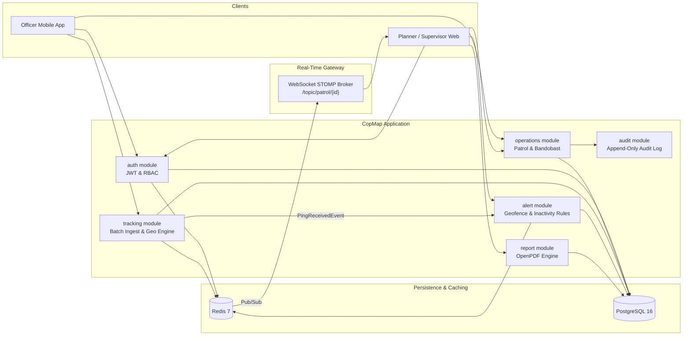

# CopMap Backend - Command, Control & Patrol Dispatch System

CopMap is a high-reliability, real-time command, control, and audit backend designed for police patrolling, VIP bandobast, and static nakabandi operations. It is built as a **Modular Monolith** using Spring Boot 3.3.5 and Java 21, backed by PostgreSQL 16 and Redis 7.

---

## 1. Problem Understanding & Operational Context

Modern field policing requires coordinated movement across beats, proactive geofence monitoring, and verifiable shift accountability. Conventional solutions suffer from three fundamental issues in field environments:
- **Intermittent Connectivity:** Field personnel operate in dense corridors, radio shadows, and low-reception zones where persistent sockets drop constantly. CopMap utilizes client-timestamped HTTP batching with PostgreSQL idempotency (`ON CONFLICT DO NOTHING`) to ensure 100% telemetry capture without duplication.
- **Double-Booking & Roster Conflicts:** Manual scheduling leads to overlapping duties. CopMap enforces strict temporal overlap validation at the database and service tier.
- **Audit Defensibility:** Legal scrutiny requires immutable evidence. Every state transition, SOS alarm, and patrol closure generates append-only audit entries and exportable PDF case dossiers via OpenPDF.

---

## 2. Architecture Overview

CopMap employs a modular monolith architecture. Modules maintain loose coupling by referencing external entities strictly through primary keys (`Long officerId`, `Long patrolId`, `Long stationId`) and communicating asynchronously across domain boundaries via Spring Application Events.



### Module Responsibilities

| Module | Scope | Interaction Mechanism |
|---|---|---|
| `auth` | Users, police stations, JWT authentication, token revocation | REST, Redis token blacklist |
| `operations.patrol` | Patrol creation, waypoints, state machine, duty start/end, closure | REST, JPA, Spring Events |
| `operations.assignment` | Personnel roster allocation, temporal conflict checking | REST, JPA, Event publishing |
| `operations.bandobast` | Bandobast/Nakabandi schemas and 501 Not Implemented API stubs | REST (501 specification) |
| `tracking` | GPS ping batch ingestion, rate limiting, async persistence, Redis GEO store | REST, Redis GEO/ZSET, Async Worker |
| `alert` | Geofence breach detection, inactivity sweepers, panic SOS handling | Event listeners, Redis Pub/Sub, Notifier |
| `report` | Formatted PDF shift reports with audit timelines and telemetry summaries | OpenPDF byte array generation |
| `common.audit` | Station and patrol-scoped append-only audit logs | REST, JPA repository |

---

## 3. Implemented vs Skipped

### Implemented
- **Authentication & RBAC:** Stateless HMAC-SHA256 JWT, 15-minute token TTL, Redis-backed logout revocation blacklist, role-based security (`OFFICER`, `PLANNER`, `SUPERVISOR`).
- **Patrol Planning & State Machine:** Strict transitions (`DRAFT → PLANNED → ACTIVE → COMPLETED`), waypoints definition, and cancellation guards.
- **Roster & Conflict Prevention:** Temporal interval conflict checking preventing double-booking across concurrent shifts.
- **Duty Execution:** Officer start/end duty flows automatically promoting patrols to `ACTIVE` upon first officer check-in.
- **High-Throughput Tracking:** Mobile batch ping ingestion, sliding-window rate limiting (30 pings/min), Redis GEO latest coordinates, Redis ZSET `lastseen` index, and asynchronous batch database persistence via `JdbcTemplate`.
- **Alert System:**
  - `GEOFENCE_BREACH`: Orthogonal point-to-segment distance calculations against route waypoints with Redis deduplication.
  - `NO_SIGNAL`: Scheduled background sweeper detecting officers inactive for > 3 minutes.
  - `LATE_START`: Scheduled background sweeper alerting on unstarted shifts.
  - `SOS`: High-priority panic alarms bypassing deduplication.
  - `ACKNOWLEDGE`: Supervisor alert acknowledgement and tracking.
- **Real-Time Streaming:** Redis Pub/Sub bridge broadcasting live updates to WebSocket STOMP subscribers on `/topic/patrol/{id}`.
- **PDF Report Generation:** Clean PDF generation using OpenPDF (`GET /api/v1/patrols/{id}/report.pdf`) compiling patrol details, waypoints, officers, alert chronologies, and audit trails.
- **Audit Trails:** Immutable logging of all sensitive administrative and field actions.
- **Automated Tests:** Unit tests for `PatrolStateMachineTest`, `ConflictCheckerTest`, `GeoUtilsTest`, and `GeofenceRuleTest`.
- **Docker Compose:** Production-ready containerization for application, PostgreSQL 16, and Redis 7.

### Skipped / Designed Only
- **Full Bandobast Logic:** Schema (`V5__bandobast.sql`), domain entities, repositories, DTOs, and controller stubs returning HTTP 501 (`ErrorCode.NOT_IMPLEMENTED`) are provided. Checkpoint allocation logic and check-in radius verification are documented for subsequent phases.
- **Refresh-Token Rotation:** Kept to single access tokens with Redis blacklisting for operational simplicity.
- **External Push Providers:** Real FCM / APNs / WhatsApp integrations replaced with `LogNotifier` and mock abstractions.
- **Distributed Event Broker:** Spring Application Events used in place of Apache Kafka.
- **PostGIS / Map Matching:** Local Euclidean flat projection (`GeoUtils`) used instead of PostGIS extensions.

---

## 4. Key Architectural Trade-Offs

1. **REST Batching vs Persistent Mobile WebSockets:**
   - *Choice:* REST batch ingestion (`POST /api/v1/locations`).
   - *Rationale:* Field cellular reception drops frequently. Local offline SQLite storage on mobile devices with idempotent batch replay ensures zero data loss without socket reconnection storms.
2. **Local Flat Projection vs PostGIS:**
   - *Choice:* In-memory flat projection in `GeoUtils.distanceToRouteMeters`.
   - *Rationale:* Beat patrols operate across local radii (< 5 km). At patrol scale, equirectangular flat projection is accurate within centimeters while eliminating database round-trips for high-velocity ping evaluation.
3. **Redis GEO & ZSET Dual Index:**
   - *Choice:* `live:patrol:{id}` (GEO) + `lastseen:patrol:{id}` (ZSET).
   - *Rationale:* Redis GEO offers O(1) position lookup and radius queries, while ZSET score indexing enables scheduled sweeper jobs to detect dropped signals in O(log N) without scanning the primary database.

---

## 5. Quick Start & Docker Deployment

### Prerequisites
- Docker Engine 24+ and Docker Compose v2+
- Ports `8080`, `5432`, `6379` available

### Running with Docker Compose
```bash
# Clone and enter the repository
cd copmap

# Start PostgreSQL, Redis, and Spring Boot application
docker compose up --build -d

# Verify containers are healthy
docker compose ps
```

The service is available at `http://localhost:8080`.
Interactive OpenAPI Swagger UI is available at:
`http://localhost:8080/swagger-ui.html`

### Running Locally with Maven
```bash
# Ensure local Postgres and Redis are running
mvn clean test
mvn spring-boot:run
```

---

## 6. Seed Credentials

All seed accounts are initialized with password `Copmap@123` via migration `V6__seed_data.sql`:

| Role | Badge Number | Full Name | Station | Purpose |
|---|---|---|---|---|
| `PLANNER` | `PLN001` | Inspector Sharma | Connaught Place (1) | Shift planning, route design, patrol closure |
| `SUPERVISOR` | `SUP001` | ACP Verma | New Delhi District (1) | Jurisdictional live oversight, alert acknowledgement |
| `OFFICER` | `OFF001` | Constable Kumar | Connaught Place (1) | Field duty execution, ping telemetry, SOS triggers |
| `OFFICER` | `OFF002` | Constable Singh | Connaught Place (1) | Patrol partner, second assigned field officer |
| `OFFICER` | `OFF003` | Constable Yadav | Connaught Place (1) | Available reserve officer |

---

## 7. Postman & Scripts

- **Postman Collection:** `docs/postman/CopMap.postman_collection.json`
- **Postman Environment:** `docs/postman/CopMap.postman_environment.json`
  - Automated test scripts automatically store `token`, `planner_token`, `supervisor_token`, `officer_token`, and entity IDs across test runs.
- **Demo Seed Script:** `scripts/seed-demo.sh`
  - Executes login, creates a demo patrol with waypoints, publishes the patrol, assigns officers, starts duty, and uploads initial pings.
  - Run via: `./scripts/seed-demo.sh`
- **Officer Telemetry Simulator:** `scripts/simulate-officer.py`
  - Simulates an officer moving along waypoints and sending real-time GPS telemetry, with optional geofence breach simulation:
  - Run via: `python3 scripts/simulate-officer.py --patrol-id 1 [--breach]`

---

## 8. Documentation Index

- [Domain Research & Field Realities](docs/research.md)
- [System Architecture & Engineering Design](docs/architecture.md)
- [REST API Contracts Specification](docs/api-contracts.md)
- [Mermaid Diagrams Source](docs/diagrams/src/)
  - [Architecture Flowchart](docs/diagrams/src/architecture.mmd)
  - [Entity Relationship Diagram](docs/diagrams/src/er-diagram.mmd)
  - [Live Tracking Sequence Diagram](docs/diagrams/src/flow-live-tracking.mmd)
  - [Patrol Lifecycle State Diagram](docs/diagrams/src/flow-patrol-lifecycle.mmd)

---

## 9. Submission Checklist

- [x] Spring Boot 3.3.5 & Java 21 Modular Monolith
- [x] Dockerfile & docker-compose.yml with PostgreSQL 16 and Redis 7
- [x] Flyway migrations V1 through V6 with seed users and test stations
- [x] JWT Authentication & Redis token blacklisting
- [x] Patrol State Machine & Conflict Prevention Checker
- [x] Live Tracking with Redis GEO, ZSET, and STOMP WebSocket
- [x] Alert Engine: Geofence Breach, No Signal Sweeper, Late Start Sweeper, SOS Panic
- [x] OpenPDF Patrol Report Generation (`GET /api/v1/patrols/{id}/report.pdf`)
- [x] Bandobast & Nakabandi skeleton (V5 migration, entities, repositories, DTOs, 501 controller)
- [x] Unit and Integration test suite (`PatrolStateMachineTest`, `ConflictCheckerTest`, `GeoUtilsTest`, `GeofenceRuleTest`)
- [x] Postman Collection & Environment with auth token extraction scripts
- [x] Domain Research, Architecture Specs, API Contracts, and Mermaid Diagrams
- [x] Seed and officer simulation scripts
