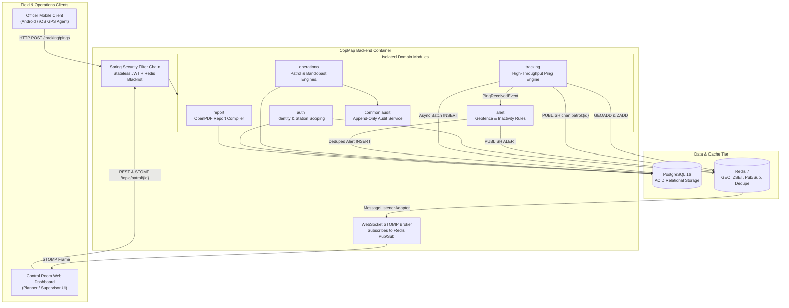

# CopMap - System Architecture & Engineering Design

## 1. Architectural Philosophy

CopMap is designed as a **Modular Monolith** built on Spring Boot 3.3.5 and Java 21. While deployed as a unified runtime container for operational simplicity and zero network hops in early phases, each domain package (`auth`, `operations`, `tracking`, `alert`, `report`) adheres to strict microservice boundaries:
- Inter-module references across aggregate roots are maintained solely by primary identifier (`Long stationId`, `Long officerId`, `Long patrolId`), never by direct cross-boundary JPA `@ManyToOne` entity joins.
- Cross-module side effects and asynchronous notifications are orchestrated through Spring Application Events (`PingReceivedEvent`, `PatrolClosedEvent`, `OfficerAssignedEvent`), ready for seamless extraction to Apache Kafka or RabbitMQ.



---

## 2. Component Breakdown

### 2.1 Authentication & RBAC (`in.copmap.auth`)
- **Credentials:** Police badge number (`badgeNo`) and BCrypt password.
- **Tokens:** Short-lived stateless HMAC-SHA256 JWTs (15-minute access window) containing `userId`, `role`, `stationId`, and unique `jti`.
- **Revocation:** Logout pushes `jwt:bl:{jti}` to Redis with TTL matching remaining token lifespan. `JwtAuthFilter` checks Redis before authenticating the request context.
- **Roles:**
  - `OFFICER`: Field duty execution, location streaming, SOS alarms.
  - `PLANNER`: Station-level operations, route planning, shift scheduling.
  - `SUPERVISOR`: Cross-station jurisdictional command, live oversight, alert triage.

### 2.2 Operations: Patrol & Bandobast (`in.copmap.operations`)
- **Patrol State Machine:** Strict transitions enforced:
  `DRAFT → PLANNED → ACTIVE → COMPLETED` (or `CANCELLED` before start).
- **Conflict Checker:** Evaluates temporal intervals (`startsAt < newEnd AND endsAt > newStart`) against non-terminal assignments (`ASSIGNED`, `ON_DUTY`) to guarantee zero officer double-booking across concurrent shifts.
- **Bandobast & Nakabandi Extension:**
  - Designed as points/sectors with required strength.
  - Reuses the shared `assignments` entity, conflict checker, and alert framework.

### 2.3 High-Throughput Tracking Pipeline (`in.copmap.tracking`)
- **Decoupled Ingest:** Mobile officers upload batches of up to 100 pings.
- **Rate Limiting:** Redis-backed sliding counter (`rl:loc:{officerId}`) caps ingest to 30 batches per minute, discarding abusive or looping field devices.
- **Redis Live Buffer:**
  - `live:patrol:{patrolId}`: Redis GEO coordinate set stores the latest longitude and latitude per officer for O(1) reads and distance queries.
  - `lastseen:patrol:{patrolId}`: Redis Sorted Set (ZSET) with score set to timestamp milliseconds enables efficient range scans for stalled or unreachable personnel.
- **Async Batch Persistence:** `PingPersistenceWorker` offloads location persistence to an asynchronous executor pool (`pingExecutor`). Database writes execute via `JdbcTemplate.batchUpdate` with PostgreSQL `ON CONFLICT (officer_id, patrol_id, recorded_at) DO NOTHING`.

### 2.4 Alert & Sweeper Engine (`in.copmap.alert`)
- **Geofence Breach Rule:** Computes orthogonal Euclidean distance from the ping coordinates to the polyline route segments defined by patrol waypoints. If distance exceeds `geofence_radius_m` (default 200 m), an alert is generated.
- **Redis Deduplication:** Key `alert:dedupe:{patrolId}:{type}:{officerId}` with configurable TTL (default 10 minutes) ensures control room supervisors are not spammed with duplicate alarms.
- **Sweeper Cron Jobs:**
  - `NoSignalSweeper`: Periodically checks `lastseen:patrol:{patrolId}` for scores older than 3 minutes, generating `NO_SIGNAL` alerts.
  - `LateStartSweeper`: Identifies officers whose scheduled shift began over 15 minutes ago but status remains `ASSIGNED`.
- **SOS Panic Trigger:** Bypasses deduplication to instantly publish `ALERT` notifications with `HIGH` severity.

### 2.5 Report Generation Engine (`in.copmap.report`)
- Implemented with LibrePDF / OpenPDF.
- Queries patrol metadata, ordered waypoints, assigned personnel, alert timelines, and audit logs.
- Emits structured, byte-array PDF documents (`GET /api/v1/patrols/{id}/report.pdf`) with professional typography, headers, and audit trails.

---

## 3. Real-Time Architecture & Horizontal Scaling

```
[Officer App] ──HTTP POST──> [CopMap App 1] ──GEOADD/ZADD──> [Redis 7]
                                    │                           │
                                    └───PUBLISH chan:patrol:12──┘
                                                │
                                    ┌───────────┴───────────┐
                                    ▼                       ▼
                           [CopMap App 1]            [CopMap App 2]
                          (Redis Subscriber)        (Redis Subscriber)
                                    │                       │
                                    ▼                       ▼
                         [STOMP WebSocket]         [STOMP WebSocket]
                                    │                       │
                                    ▼                       ▼
                          [Supervisor UI A]         [Supervisor UI B]
```

1. Field updates are published to Redis channel `chan:patrol:{id}`.
2. Every Spring Boot instance running `RedisLiveSubscriber` receives the message via Redis Pub/Sub.
3. The subscriber forwards the payload to the local `SimpMessagingTemplate`, broadcasting to STOMP topic `/topic/patrol/{id}`.
4. Clients falling back to HTTP polling query `GET /api/v1/tracking/patrols/{id}/live`, reading from the Redis GEO set.

---

## 4. Key Architectural Trade-Offs

| Decision | Selected Approach | Alternative Considered | Justification |
|---|---|---|---|
| Ingest Protocol | REST Batching (`/tracking/pings`) | Persistent WebSocket from mobile | Mobile cell coverage in police beats drops frequently. HTTP batching with local SQLite queue and idempotent retry is resilient to carrier connection drops. |
| Geo Calculation | Local Flat Projection in `GeoUtils` | PostGIS `ST_DWithin` / GIS queries | Beat and patrol radii are small (< 5 km). At patrol scale, local equirectangular flat projection is microsecond-fast, computes in Java memory, and avoids database round-trips for high-velocity ping streams. |
| In-Memory Cache | Redis GEO + ZSET | Caffeine / Local JVM memory | Allows stateless application nodes to scale horizontally behind a load balancer without sticky sessions. |
| Real-time Message Bus | Redis Pub/Sub | Apache Kafka / RabbitMQ | Zero additional operational infrastructure; Redis is already deployed for caching, session blacklisting, and rate limiting. |
| Monolith Architecture | Modular Monolith | Microservices with gRPC | Team operational efficiency, single Docker image deployment, simplified transactions during early delivery stages, with clear module decoupling for future extraction. |

